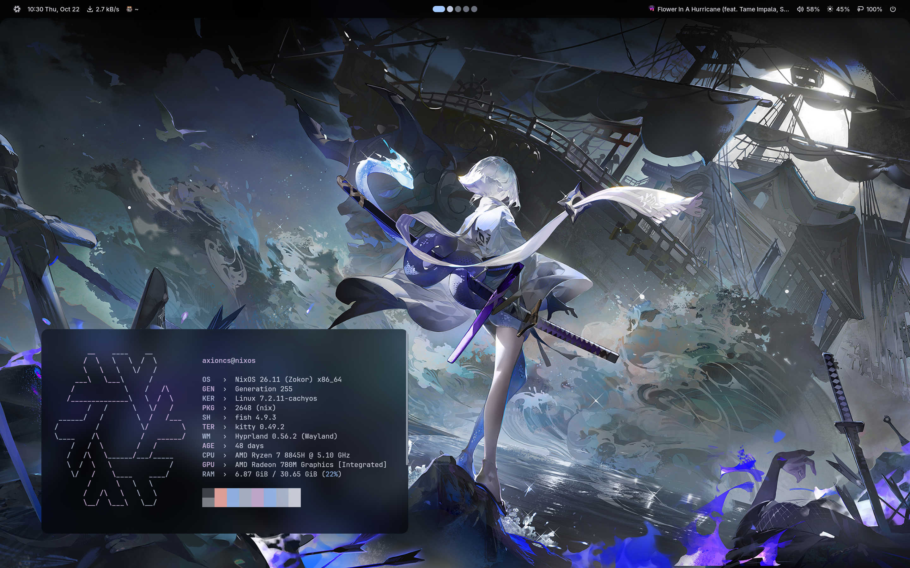

# nixos

Personal NixOS flake config (Hyprland desktop, home-manager, etc).



## Install

1. Boot a NixOS installer, partition your disks, mount at `/mnt`.

2. Clone the config directly into the target system:
   ```sh
   git clone https://github.com/axioncs/nixos /mnt/home/<your-username>/nixos
   cd /mnt/home/<your-username>/nixos
   ```

3. Regenerate hardware config for this machine:
   ```sh
   sudo nixos-generate-config --root /mnt
   cp /mnt/etc/nixos/hardware-configuration.nix modules/nixos/filesystems.nix
   ```

4. Edit `modules/axioncs/settings.nix` with your own values:
   ```nix
   username     = "axioncs";   # -> your username
   hostname     = "nixos";     # -> your hostname
   stateVersion = "26.05";     # -> leave matching your install ISO's version
   desktop      = "hyprland";  # -> hyprland | umbriel | mango | sway | labwc
   ```

5. Handle machine-specific dependencies (skip any that don't apply):
   - `modules/nixos/nix.nix` references `/etc/nix-secrets/netrc` and `/etc/nix-secrets/github-token.conf` for GitHub auth. Create those files, or remove the `netrc-file` line and `extraOptions` block.
   - `modules/nixos/boot.nix` uses `linuxPackages_cachyos-lto-znver4` (ThinLTO, built for Zen 4 only; it won't run on other CPUs) and AMD-specific kernel params (`amd_pstate=active`). Swap to `linuxPackages_cachyos` or a stock kernel if you're not on Zen 4.
   - `modules/nixos/desktop.nix` enables `chaotic.mesa-git` (bleeding-edge Mesa from nyx). Remove it if you want stable Mesa.

6. Install:
   ```sh
   sudo nixos-install --flake .#nixos
   ```

7. Give ownership of the flakes directory to your user:
   ```sh
   sudo chown -R <your-username>:users /mnt/home/<your-username>/nixos
   ```

8. Reboot, log in, then apply home-manager (should happen automatically as part of the system activation via the flake, but to re-apply manually):
   ```sh
   nh os switch ~/nixos
   ```

9. Once you're on the desktop, run `hyprctl monitors` and update the hardcoded monitor names/resolutions/scale in `desktops/hyprland/cfg/display.lua` (`eDP-1`, `HDMI-A-1`, etc) to match your actual outputs.

## Rebuilding after changes

```sh
nh os switch ~/nixos
```

Edit config files with `hx` (Helix).

## Credits

Built on top of / pulls from:
- [noctalia-dev/noctalia](https://github.com/noctalia-dev/noctalia)
- [numtide/llm-agents.nix](https://github.com/numtide/llm-agents.nix)
- [OpalAayan/snappy-switcher](https://github.com/OpalAayan/snappy-switcher)
- [chaotic-cx/nyx](https://github.com/chaotic-cx/nyx) (CachyOS kernel, mesa-git)
- [Gerg-L/spicetify-nix](https://github.com/Gerg-L/spicetify-nix)
- [0xc000022070/zen-browser-flake](https://github.com/0xc000022070/zen-browser-flake)
- [nix-community/home-manager](https://github.com/nix-community/home-manager)

## License

MIT — see [LICENSE](LICENSE).
